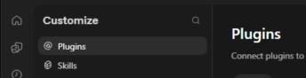
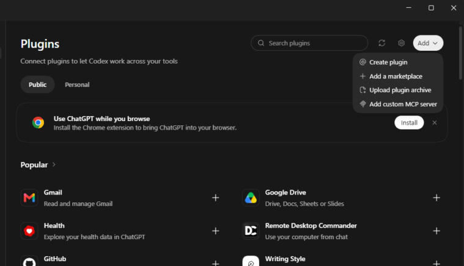
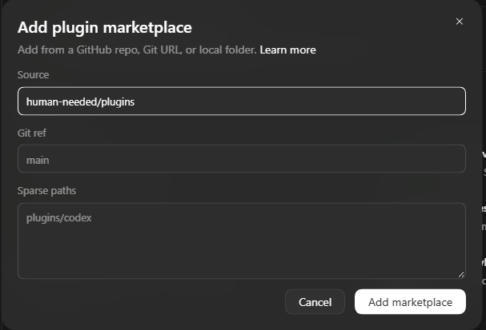
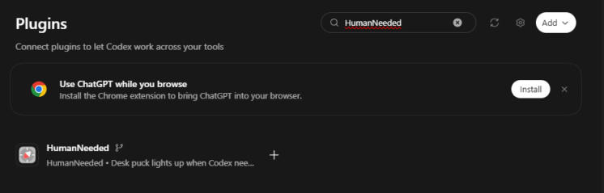
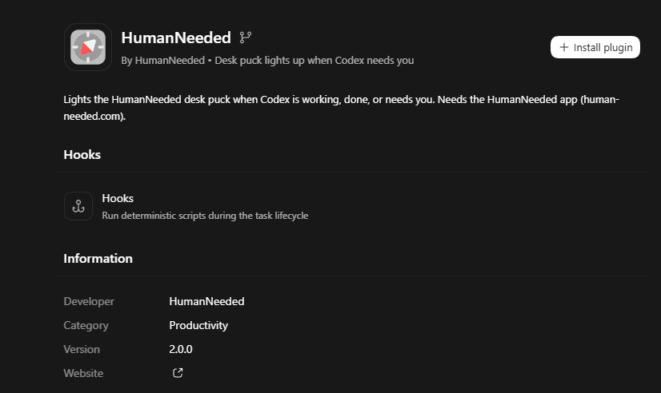
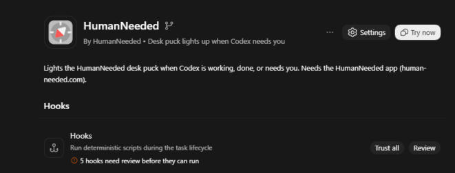
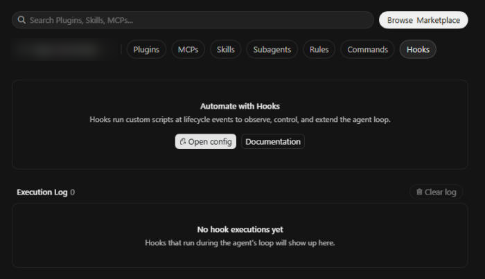

# HumanNeeded plugins

[](https://github.com/human-needed/plugins/actions/workflows/test.yml)

Agent integrations for the [HumanNeeded](https://human-needed.com) puck: a USB desk light that
glows and chimes when your AI coding agent is working, done, or needs you.

The **HumanNeeded app** runs on your computer and owns the puck. Install the app first, then
add the agents you use below. Each one sends its state to the app on your computer only
(`http://127.0.0.1:24816`). If the app isn't running, nothing happens.

## Claude (desktop app: Code tab and Cowork)

1. Open the Claude app.
2. Click **Customize** (bottom left).
3. Click **Plugins**.
4. Click **Add marketplace**, type `human-needed/plugins`, click **Add**.
5. Find **HumanNeeded** and click **Install**.
6. For Cowork only: in the HumanNeeded app, turn on the **cloud link**.
7. Check: start a new chat or task. The puck lights up while Claude works and shows "done" when it finishes.

<details>
<summary>Prefer commands? (Claude Code in a terminal, VS Code or the desktop Code tab)</summary>

Choose one way. They do the same thing as the steps above.

**Inside Claude Code**

1. Type `/plugin marketplace add human-needed/plugins` and press Enter.
2. Type `/plugin install humanneeded@humanneeded` and press Enter.
3. Turn on updates: type `/plugin`, open **Marketplaces**, pick **humanneeded**, choose **Enable auto-update**.
4. Start a new session.
5. Check: send a message. The puck lights up, then shows "done".

**In a terminal**

1. Run `claude plugin marketplace add human-needed/plugins`
2. Run `claude plugin install humanneeded@humanneeded`
3. Start a new Claude Code session.
4. Check: send a message. The puck lights up, then shows "done".

</details>

Ask Claude "test my puck", "mute for an hour" or "make needs purple".
If you use an HTTP proxy, add `127.0.0.1` to `NO_PROXY`.
In Cowork the plugin's [`cloud/hn-cloud.sh`](plugins/claude/cloud/hn-cloud.sh) sends each state
through the HumanNeeded relay to the app. On your own computer it does nothing.

## Codex (desktop app)

1. Open the Codex app.
2. Click **Customize** in the left bar.

   

3. Click **Add** (top right), then **Add a marketplace**.

   

4. Type `human-needed/plugins` in **Source** and click **Add marketplace**.

   

5. Search for **HumanNeeded** and click it.

   

6. Click **Install plugin**.

   

7. Under **Hooks**, click **Trust all**. (Codex runs plugin hooks only after you trust them.)

   

8. Check: start a chat and send a message. The puck lights up, then shows "done".

<details>
<summary>Prefer commands? (Codex CLI)</summary>

1. Run `codex plugin marketplace add human-needed/plugins`
2. Run `codex plugin add humanneeded@humanneeded`
3. Start Codex, type `/hooks` and trust the HumanNeeded hooks.
4. Check: send a message. The puck lights up, then shows "done".

To update: `codex plugin marketplace upgrade humanneeded`, then trust the changed hooks again.

</details>

Set up the old way (our entries in `~/.codex/hooks.json`)? Delete those entries, or the puck gets
every event twice.

## Cursor (desktop app)

1. Open Cursor.
2. Click **Customize** in the left sidebar.
3. Click **Hooks**, then **Open config**.

   

4. Open our hooks file: [macOS / Linux](https://raw.githubusercontent.com/human-needed/plugins/main/plugins/cursor/hooks.json)
   or [Windows](https://raw.githubusercontent.com/human-needed/plugins/main/plugins/cursor/hooks.windows.json).
   Copy all of it.
5. If the config is empty, paste it in. If it already has hooks, add each of our entries under
   `"hooks"` instead.
6. Save (Ctrl+S, or Cmd+S on a Mac).
7. Check: send a message in Cursor's agent. The puck lights up, then shows "done".

Cursor shows working and done only (it has no "needs you" hook). A one-click Cursor plugin needs a
Cursor Marketplace listing (not yet).

<details>
<summary>Prefer commands?</summary>

Run the command for your computer. It never overwrites a file you already have.

macOS / Linux:

```bash
[ -e ~/.cursor/hooks.json ] || { mkdir -p ~/.cursor && curl -fsSL -o ~/.cursor/hooks.json https://raw.githubusercontent.com/human-needed/plugins/main/plugins/cursor/hooks.json; }
```

Windows (PowerShell):

```powershell
if (!(Test-Path $HOME\.cursor\hooks.json)) { mkdir -Force $HOME\.cursor | Out-Null; curl.exe -fsSL -o $HOME\.cursor\hooks.json https://raw.githubusercontent.com/human-needed/plugins/main/plugins/cursor/hooks.windows.json }
```

Check: send a message in Cursor's agent. The puck lights up, then shows "done".

</details>

## Layout

```
.claude-plugin/marketplace.json   Claude Code marketplace (this repo)
plugins/claude/                   Claude Code plugin "humanneeded": HTTP hooks, cloud hook, skill
plugins/codex/                    Codex plugin "humanneeded" (.codex-plugin/, hooks.json: curl, assets/icon.png)
docs/images/                      screenshots for the install guides
.agents/plugins/marketplace.json  Codex marketplace (this repo)
plugins/cursor/hooks*.json        Cursor hooks (curl; macOS/Linux and Windows)
integrations/manifest.json        how the app detects each installed integration
tools/gen-hooks.mjs               generates every hook file from one mapping table
tests/run.mjs                     tests; tests/fake-hub.mjs is a stand-in for the app
relay/                            the old cloud relay (being replaced)
```

Edit the mapping in `tools/gen-hooks.mjs`, never the hook files, then:

```bash
node tools/gen-hooks.mjs
```

```bash
node tests/run.mjs
```

To release a change, bump `version` in `plugins/claude/.claude-plugin/plugin.json` and push.
